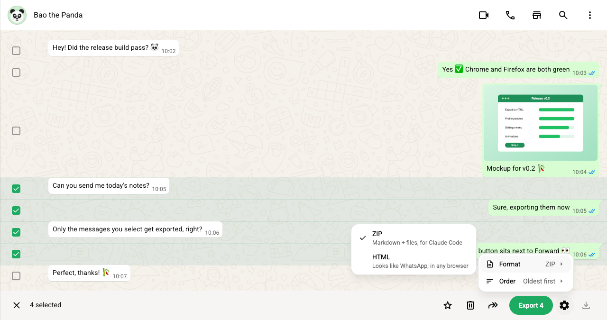
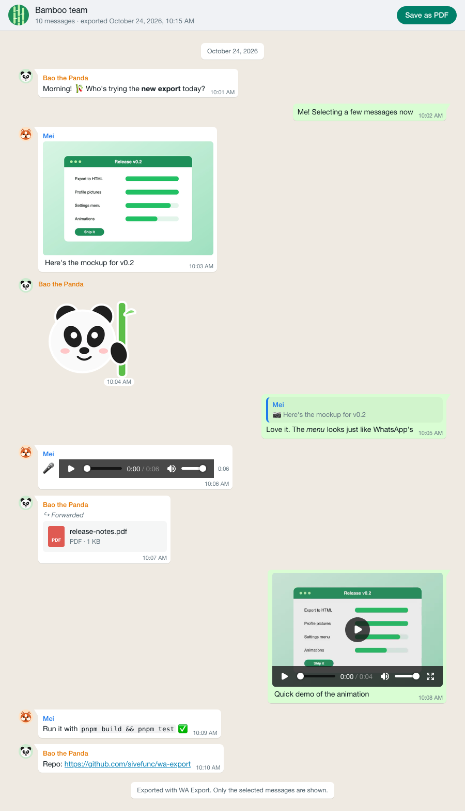

# WA Export for WhatsApp Web


[](https://github.com/sivefunc/wa-export/actions/workflows/ci.yml)

Select messages in WhatsApp Web the way you would to forward them, click **Export**, and save them as a **ZIP**, an **HTML** page, a **PDF** or an **image**. For sharing a conversation with people, or handing it to a coding agent.

Chrome/Chromium 111+ and Firefox 128+. Everything runs locally; see [PRIVACY.md](PRIVACY.md).

<picture>
  <source media="(prefers-color-scheme: dark)" srcset="docs/images/whatsapp-menu-dark.png">
  
</picture>

<sub>A fictional chat, made for this screenshot. See [docs/demo](docs/demo/README.md).</sub>

## Use it

1. Open a chat in WhatsApp Web → ⋮ → **Select messages**.
2. Tick the messages you want. Scrolling is fine; ticks out of view are kept.
3. Click **Export N**, next to Forward in the selection toolbar. The ⚙ beside it picks the format and its options (the same settings as the extension's options page).

## Exports

| Format | What you get |
|---|---|
| **ZIP** | `chat.md` (the conversation as Markdown), `messages.json` (the same, structured) and `media/` with every original file. Made for coding agents and scripts. |
| **HTML** | One page that looks like WhatsApp, opening in any browser: photos, stickers, voice notes and videos that play, documents to download. |
| **PDF** | The same look on A4 pages. Text can be searched and copied. |
| **Image** | The same look as one PNG or JPEG. Long chats can be split into parts. |

PDF and images have a **Quality** option (Best, Balanced, Small) that trades sharpness for file size. Everything follows WhatsApp's light or dark theme.

<p align="center">
  <picture>
    <source media="(prefers-color-scheme: dark)" srcset="docs/images/html-export-dark.png">
    
  </picture>
</p>

Try one: download [docs/demo/bamboo-team.html](docs/demo/bamboo-team.html).

<details>
<summary>Details</summary>

- **ZIP layout:**
  ```
  <chat>-<YYYY-MM-DD-HHmm>.zip
  ├── chat.md        sender, time, replies, formatting as Markdown; files linked where they were sent;
  │                  problems marked where they happened
  ├── messages.json  the same data, structured (schemaVersion 1)
  └── media/         original photos, videos, voice notes, PDFs, documents
  ```
- **Albums** export every photo. A reply to a file keeps the reply text plus a mention such as `_(Video)_`; the quoted file itself is only included if you select it too.
- **Profile pictures** (HTML, PDF, image) are the small ones WhatsApp shows in chat lists. People without one, or who hide it from you, get their initial.
- **HTML** embeds files as base64, about a third larger than the media. Its **Save as PDF** button opens the print dialog.
- **PDF and images** show a video's first frame and a drawn voice-note player; the files themselves come with ZIP and HTML. A chat too long for one image (roughly 150 messages and up) is refused unless ⚙ → **Long images** → **Split into parts** is on, which gives a ZIP of images cut between messages.
- **Size:** HTML, PDF and images ask before exporting over 200 MB of media and refuse over 500 MB; ZIP asks over 500 MB and refuses over 1.5 GB.

</details>

## Install

- **Chrome:** `pnpm build`, then `chrome://extensions` → Developer mode → **Load unpacked** → `.output/chrome-mv3`.
- **Firefox (temporary, until restart):** `pnpm build`, then `about:debugging#/runtime/this-firefox` → **Load Temporary Add-on…** → `.output/firefox-mv3/manifest.json`.
- **Firefox (permanent):** `pnpm sign:firefox` signs the build privately on AMO's unlisted channel. It needs AMO API keys in `.env.local`, as described in the script. Drag the resulting `.xpi` from `web-ext-artifacts/` onto Firefox.

## Known limitations

- **Expired files** (older media WhatsApp's servers no longer have) are reported as "expired on WhatsApp, not re-requested". The extension blocks WhatsApp's automatic re-upload request, because that would ask the sender's phone to upload the file again.
- **View-once media** is skipped on purpose.
- **Voice notes** are exported as audio but not transcribed.
- **WhatsApp updates can break it.** Everything WhatsApp-specific lives in two places:
  - `src/dom/selectors.ts`: page markup
  - `src/page/`: WhatsApp internals through WA-JS

  `docs/live-checklist.md` records what was verified and on which WhatsApp version.
- Using an unofficial extension with WhatsApp is against its terms of service. This one only reads, and only when you click Export, but the risk isn't zero.

## Develop

```sh
pnpm install
pnpm build && pnpm zip && pnpm test
```

See [CONTRIBUTING.md](CONTRIBUTING.md) for the architecture, live testing against WhatsApp Web, the Firefox checks, and the rules every change must keep.

### Updating WA-JS

WA-JS runs inside your WhatsApp session with full access, so treat upgrades as a review:

1. Read the release notes at https://github.com/wppconnect-team/wa-js/releases.
2. Diff the old and new `dist/wppconnect-wa.js`.
3. Bump the **exact** version in `package.json` (no `^`), run `pnpm install`, then run the live checklist.

### Store submission

The manifest name is a placeholder: WhatsApp is Meta's trademark, so the public name must not start with "WhatsApp" and must not use its logo. Pick the final name before submitting. Firefox submissions need the sources ZIP that `pnpm zip` creates.

## License

[MIT](LICENSE). Bundled third-party code keeps its own licenses; see [THIRD_PARTY_NOTICES.md](THIRD_PARTY_NOTICES.md).
